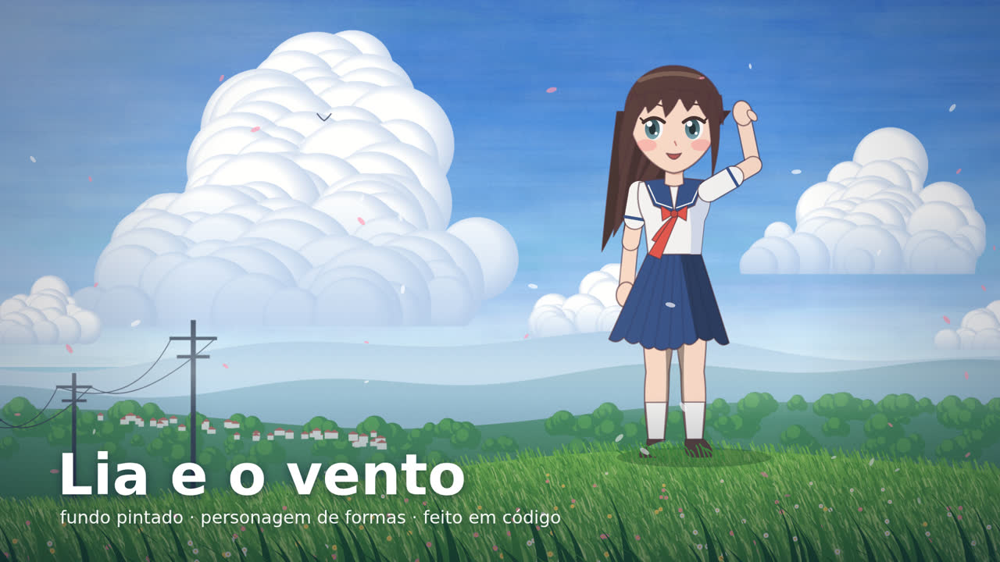
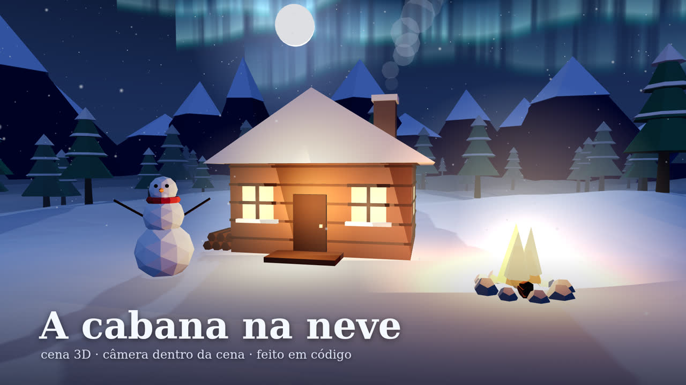
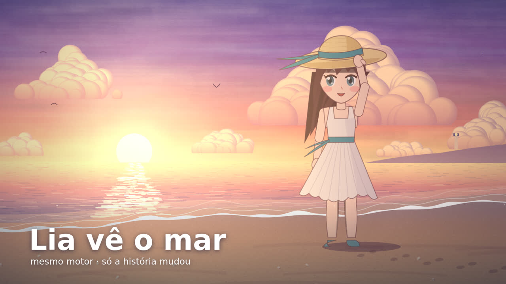
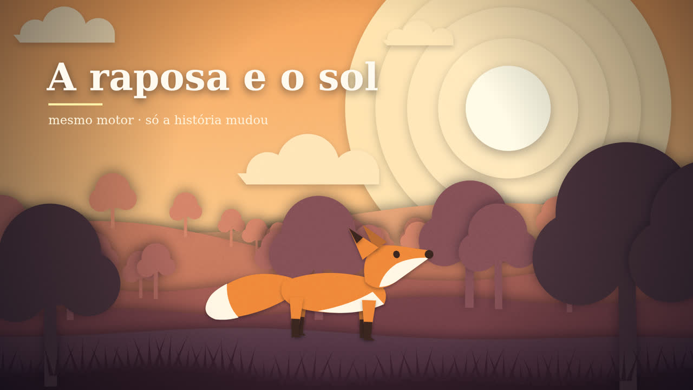

# filme-em-codigo — one engine per style

**🇧🇷 [Português](README.md) · 🇺🇸 [English](README.en.md) · 🇪🇸 [Español](README.es.md)**

[](https://linnoff88-dev.github.io/

**Change your character’s clothes and setting without the AI changing their face.** The method is called
**one engine per style**: approve the character once, then reuse them in as many films as you like.

## 📖 Guide

To understand what the kit does and how it can change your day (without the technical details):
**https://linnoff88-dev.github.io/

## What it is

Tired of asking for a new outfit and getting a different character? In this free kit, Claude writes
an **artist** in code who knows how to draw a style, and a short scene **sheet**: who appears,
where, when, and what they do. For a new film, you change the sheet and keep the artist, so the
face stays the same. It’s for anyone who wants to make animated films without knowing how to
program. You need Claude Code (or Codex) and an ordinary computer, no graphics card.

<sub>The example engines in this kit were written by Claude Fable 5.2.</sub>

> The other documents and ready-to-use prompts in this kit are in Portuguese. This README is a translation.

You ask AI for a video, and the character’s face changes with every shot, the film ends after a few
seconds, and every new attempt costs credits. Here’s a different approach: Claude **writes a
program that draws the film**, frame by frame. No video model and no graphics card.

The method has a name: **one engine per style**. You create an engine for a style once. After that,
a new film only requires changing the story. And the same code always produces the same video.

| | |
|---|---|
|  **camadas-planas** · paper cutout |  **fundo-pintado** · painted background + character made of shapes |
|  **cena-3d** · 3D world with the camera inside |  **marionete** · an illustration animated by its parts |

The four frames above came from the engines in this repository, in this order: code → frames →
sound → MP4.

## How it works

1. **The engine** is a page (HTML + JavaScript) that knows how to draw in a style. It has a function,
   `desenhar(t)`, that draws the frame at second `t`.
2. **The story** is a small file, `historia.json`: title, colors, place, time, clothes, action.
3. **The render** opens the page in a headless browser, requests each frame (`t = 0`, `t = 1/30`,
   `t = 2/30`...) and saves each one as an image.
4. **Sound** is calculated too: the engine calculates each sample at the same timestamps as the image.
5. **FFmpeg** combines the frames and sound into an MP4.

Because the timing doesn’t come from a clock and random choices use a seed, **rendering twice produces
the same frames** (the kit’s test compares the hash).

## One engine per style: the proof

Same engine, same code files. Only `historia.json` changed.

| `historia.json` | `historia-2.json` |
|---|---|
|  |  |
| hill, daytime, uniform, waves | beach, sunset, dress and hat, holds her hat |
|  |  |
| night, moon, pine trees, fireflies | morning, sun, round trees |

Lia has the same face in both because the same code draws her. In `fundo-pintado`, the engine has
about 46 KB of code; each story is under 1 KB.

## How to get started (without being technical)

Open Claude Code or Codex in a folder on your computer and paste this (replace the part in brackets):

```text
Read the "filme-em-codigo" kit at https://github.com/linnoff88-dev/filme-em-codigo (the README explains everything, including installation).
I want an animated film with this character: [describe who they are, where they are, what time it is, and what they are doing].
Before doing anything, answer me in plain English:
1. Which of the 4 ways to animate fits my idea, and why?
2. What does my computer need to make the film?
3. What won't the method be able to do for my idea?
Don't install or create anything yet. Show me the plan and wait for me to say yes.
```

---

## Technical installation

### What you need

| What | What it’s for | How to check |
|---|---|---|
| Node 22 or newer | run the render | `node --version` |
| Chrome or Chromium | capture the frames (without opening a window) | the render finds it automatically; or `CHROME_PATH=/caminho` |
| FFmpeg | combine frames and sound into an MP4 | `ffmpeg -version` |
| Claude Code | write new engines and stories | only needed to create them; not needed to run the examples |

There’s no `npm install`. three.js (for the 3D example) is already in `vendor/three`.

### Get started

```bash
git clone https://github.com/linnoff88-dev/filme-em-codigo.git
cd filme-em-codigo

# renderizar um exemplo (sai em saida/fundo-pintado/fundo-pintado.mp4)
node ferramentas/render.mjs exemplos/fundo-pintado

# o mesmo motor com outra história
node ferramentas/render.mjs exemplos/fundo-pintado --historia historia-2.json

# só 3 quadros soltos, para olhar antes de renderizar tudo
node ferramentas/render.mjs exemplos/cena-3d --quadros 1,5,9

# assistir no navegador, com som, sem renderizar
node ferramentas/ver.mjs exemplos/marionete
```

## The process, from start to finish

Who does what: 🧠 you with Claude · ⚙️ script · 🤖 `claude -p` (Claude without a conversation, in a command line).

| # | Step | Command / action | Who |
|---|---|---|---|
| 1 | Choose how to animate | read [METODOS.md](METODOS.md): camadas-planas, fundo-pintado, cena-3d or marionete | 🧠 |
| 2 | Choose a style | pick a block in [prompts/estilos/](prompts/estilos/README.md) or describe your own | 🧠 |
| 3 | Create the engine (once per style) | request in [prompts/01-criar-motor.md](prompts/01-criar-motor.md), in a new conversation | 🧠 |
| 4 | Check 3 frames | `node ferramentas/render.mjs meus/<estilo> --quadros 1,4,7` and take a look; up to 3 rounds | 🧠 + ⚙️ |
| 5 | Watch in the browser (optional) | `node ferramentas/ver.mjs meus/<estilo>` | ⚙️ |
| 6 | Render the film | `node ferramentas/render.mjs meus/<estilo>` → `saida/<estilo>/<estilo>.mp4` | ⚙️ |
| 7 | Adjust with words | “slower,” “warmer light,” in the same conversation; repeat steps 4 and 6 | 🧠 |
| 8 | Make a new film with the same engine | request in [prompts/02-nova-historia-mesmo-motor.md](prompts/02-nova-historia-mesmo-motor.md): just a `historia-N.json` | 🧠 or 🤖 |
| 9 | Render the new story | `node ferramentas/render.mjs meus/<estilo> --historia historia-N.json` | ⚙️ |
| 10 | Check that nothing broke | `bash tests/rodar.sh` | ⚙️ |
| 11 | (Optional) Add texture with a video generator | [prompts/06-hibrido-modelo-de-video.md](prompts/06-hibrido-modelo-de-video.md); outside the kit, paid | 🧠 |

Step 8 without a conversation:

```bash
# --allowedTools deixa o Claude ler, criar arquivo e rodar só o render (testado em 19/11/2026)
claude -p "Use o motor de exemplos/camadas-planas. Nêo altere o motor. Crie exemplos/camadas-planas/historia-3.json: a raposa numa floresta de outono, de dia. Renderize com node ferramentas/render.mjs exemplos/camadas-planas --historia historia-3.json e diga o caminho do MP4." \
  --allowedTools "Read" "Write" "Glob" "Grep" "Bash(node ferramentas/render.mjs:*)"
```

## The 4 ways to animate

| Way | What it is | Example | When to use it |
|---|---|---|---|
| **camadas-planas** | flat shapes in layers; the background moves less than the foreground | [exemplos/camadas-planas](exemplos/camadas-planas) | paper cutout, woodcut, chalk, vector |
| **fundo-pintado** | a background painted once + a character made of shapes animated on top | [exemplos/fundo-pintado](exemplos/fundo-pintado) | a character with a face, simple anime style |
| **cena-3d** | a 3D world with light and shadow, with the camera moving through it | [exemplos/cena-3d](exemplos/cena-3d) | camera movement, depth, miniature set |
| **marionete** | a finished illustration bent by small sections | [exemplos/marionete](exemplos/marionete) | you already have the drawing and just want to bring it to life |

Details, strengths, and weaknesses of each: [METODOS.md](METODOS.md).

## Measured on this machine

Example renders on 11/19/2026: 10 seconds of film, 1920×1080, 30 frames per second
(300 frames), **CPU only, no graphics card**, 4 browsers in parallel, 8 GB memory limit.
Each row comes from the example’s `medida.json`.

| Example | Full render | Per frame | Cores used (average) | Memory (peak) | MP4 |
|---|---|---|---|---|---|
| camadas-planas | 30.8 s | 87 ms | 3.4 of 20 | 2.6 GB | 5.5 MB |
| fundo-pintado | 25.5 s | 62 ms | 3.6 of 20 | 2.5 GB | 9.1 MB |
| cena-3d | 45.3 s | 104 ms | 10.7 of 20 | 2.3 GB | 7.3 MB |
| marionete | 37.0 s | 98 ms | 3.2 of 20 | 3.1 GB | 5.4 MB |

Machine: 20-core Arm Cortex-X925 CPU, Linux, Chrome 158 (WebGL calculated by the CPU,
SwiftShader), FFmpeg 6.1.1. Times vary on other machines. The real cost is the conversation
with Claude, not the render: [CUSTO.md](CUSTO.md).

To measure on your machine: `bash ferramentas/medir-tudo.sh`.

## What’s here

| Folder / file | What it is |
|---|---|
| `exemplos/<jeito>/` | one engine for each style: `index.html`, `motor.js`, `historia.json`, `medida.json`, `quadro.jpg` |
| `comum/filme.js` | the part shared by every engine: reads the story, creates the canvas, connects it to the render, preview player |
| `comum/som.js` | sound made with code: note, bell, string, wind, beat, room echo |
| `ferramentas/render.mjs` | page → PNG frames → WAV sound → MP4. No npm dependencies |
| `ferramentas/ver.mjs` | watch the engine in the browser |
| `ferramentas/medir-tudo.sh` | renders all examples and records the measurements |
| `prompts/` | 6 ready-to-use prompts and the [style library](prompts/estilos/README.md) (31 styles) |
| `tests/` | short render, same code = same frames, MP4 with video and sound |
| `vendor/three/` | three.js 0.187.0 (MIT license), so the 3D example runs offline |

## The engine contract

Every engine exposes this on the page (created by `comum/filme.js`):

```js
window.FILME = {
  largura, altura, fps, duracao,
  tela,          // o canvas onde tudo é desenhado
  pronto,        // promessa: resolve quando história e imagens carregaram
  desenhar(t),   // desenha o quadro do segundo t — conta pura, sem relógio e sem memória
  som(),         // devolve { taxa, esq, dir }: as amostras do som, calculadas em código
};
```

Three rules make the method work:

- **`desenhar(t)` doesn’t remember the previous frame.** Wind, particles, camera: everything comes from `t`.
- **Use seeded random choices only** (`Filme.sorteio(semente)`). Never use `Math.random`.
- **Keep the story out of the engine.** Anything that changes between episodes goes in `historia.json`.

## Ready-to-use prompts

| File | What it’s for |
|---|---|
| [01-criar-motor.md](prompts/01-criar-motor.md) | create an engine for a style, with a check of 3 frames |
| [02-nova-historia-mesmo-motor.md](prompts/02-nova-historia-mesmo-motor.md) | make a new film without changing the engine |
| [03-com-sua-referencia.md](prompts/03-com-sua-referencia.md) | start from one of your images |
| [04-grade-storyboard.md](prompts/04-grade-storyboard.md) | 2×2 grid of keyframes → animation that transitions between them |
| [05-gastar-menos.md](prompts/05-gastar-menos.md) | cost-saving options, built into the prompts |
| [06-hibrido-modelo-de-video.md](prompts/06-hibrido-modelo-de-video.md) | use the MP4 as a reference in a video generator (documented only) |
| [estilos/](prompts/estilos/README.md) | 31 “same style, your idea” styles, across the 4 approaches |

## Tests

```bash
bash tests/rodar.sh
```

For each example: renders 1 second, checks that the MP4 has video and sound, renders again in
another run (with 1, 2, and 3 browsers) and compares the frame hashes, checks that the frames
change over time, and that the second story creates a different film with the same engine. Runs offline.

“Same code = same video” has been confirmed **on the same machine and in the same browser**. Across
different machines, fonts and browser versions may change a few pixels.

## What this method can’t do

Photorealism, realistic human faces, fights, dancing, or speech with synchronized mouth movements. See
[LIMITES.md](LIMITES.md) for the workarounds: the hybrid approach and Blender.

## Related kits

- **video-codigo**: video in HTML/Canvas with local voice synchronized to each word — https://linnoff88-dev.github.io/
- **sincronia-em-codigo**: a single clock for image, counter, and sound; series from a spreadsheet — https://linnoff88-dev.github.io/
- **estilo-em-skill**: a video’s style becomes a reusable skill — https://linnoff88-dev.github.io/

Open-source code repositories that support this method, checked one by one: [REFERENCIAS.md](REFERENCIAS.md).

## License

MIT. See [LICENSE](LICENSE). The three.js in `vendor/three` has its own MIT license (`vendor/three/LICENSE`).
Open and free content from ARCKHÉ AI.
