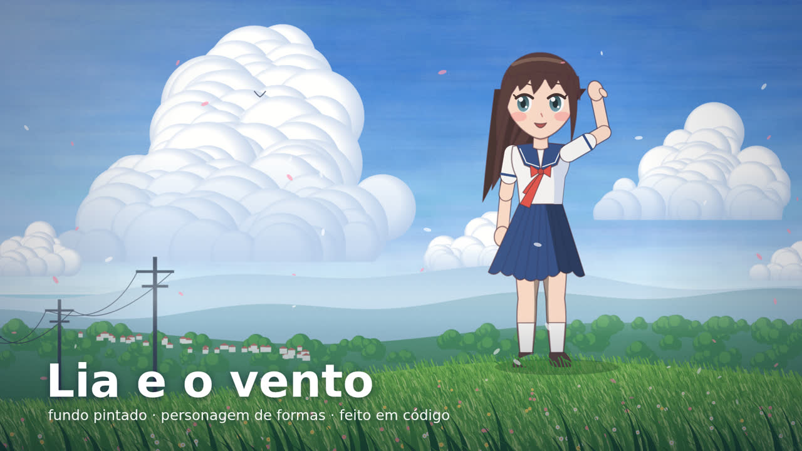
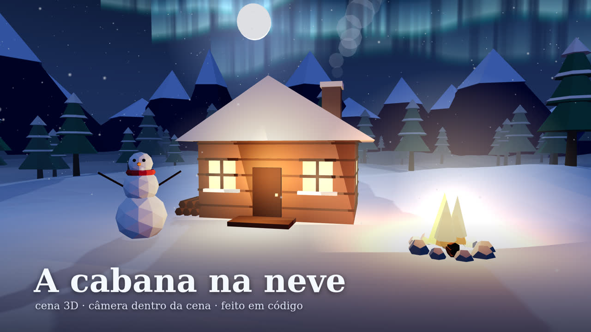
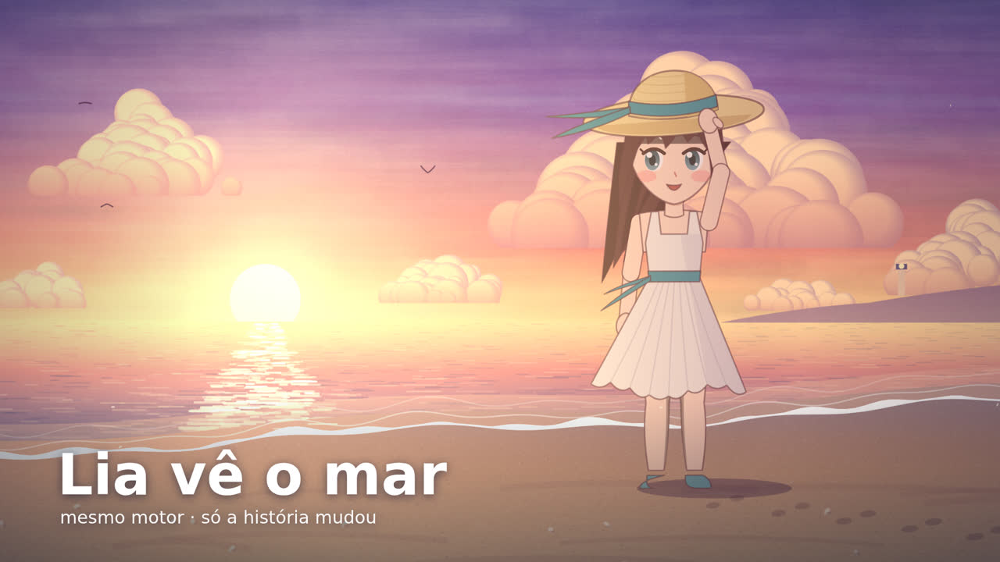
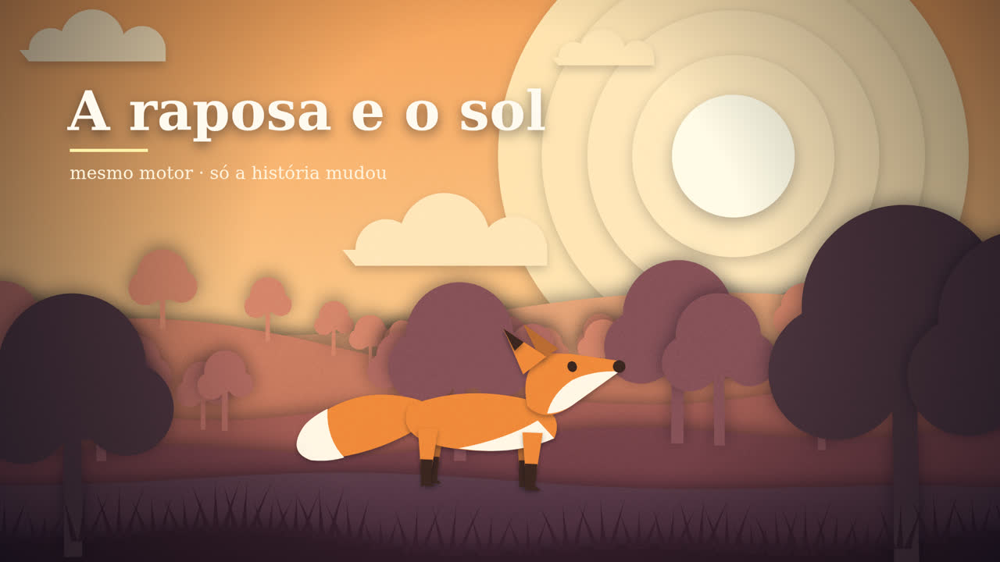

# filme-em-codigo — un motor por estilo

**🇧🇷 [Português](README.md) · 🇺🇸 [English](README.en.md) · 🇪🇸 [Español](README.es.md)**

[](https://inematds.github.io/filme-em-codigo/guia/es/)

**Cambia la ropa y el lugar de tu personaje sin que la IA le cambie el rostro.** El método se llama
**un motor por estilo**: apruebas al personaje una vez y lo reutilizas en tantas películas como quieras.

## 📖 Guía

Para entender qué hace el kit y cómo cambia tu día (sin parte técnica):
**https://inematds.github.io/filme-em-codigo/guia/es/**

## Qué es

¿Cansado de pedir solo ropa nueva y recibir otro personaje? En este kit gratis, Claude escribe
un **dibujante** en código, que sabe dibujar un estilo, y una **ficha** breve de la escena: quién
aparece, dónde, a qué hora y qué hace. Para una película nueva, cambias la ficha y el dibujante se
queda, por eso el rostro no cambia. Sirve para quien quiere hacer una película animada sin saber
programar. Necesitas Claude Code (o Codex) y una computadora común, sin tarjeta gráfica.

<sub>Los motores de ejemplo de este kit fueron escritos por Claude Fable 5.2.</sub>

> Los demás documentos y las solicitudes listas de este kit están en portugués. Este README es una traducción.

Le pides un video a la IA y el personaje cambia de rostro en cada toma, la película termina en pocos
segundos y cada nuevo intento consume créditos. Aquí el camino es otro: Claude **escribe un
programa que dibuja la película**, cuadro por cuadro. Sin modelo de video y sin tarjeta gráfica.

El método tiene nombre: **un motor por estilo**. Creas el motor de un estilo una vez. Después,
para hacer una película nueva solo cambias la historia. Y el mismo código siempre genera el mismo video.

| | |
|---|---|
|  **camadas-planas** · recorte de papel |  **fundo-pintado** · fondo pintado + personaje de formas |
|  **cena-3d** · mundo 3D con la cámara adentro |  **marionete** · una ilustración animada por áreas |

Los cuatro cuadros de arriba salieron de los motores de este repositorio, en este orden: código → cuadros →
sonido → MP4.

## Cómo funciona

1. **El motor** es una página (HTML + JavaScript) que sabe dibujar un estilo. Tiene una función,
   `desenhar(t)`, que dibuja el cuadro del segundo `t`.
2. **La historia** es un archivo pequeño, `historia.json`: título, colores, lugar, hora, ropa, acción.
3. **El renderizado** abre la página en un navegador sin pantalla, pide cada cuadro (`t = 0`, `t = 1/30`,
   `t = 2/30`...) y guarda cada uno como imagen.
4. **El sonido** también se calcula: el motor calcula cada muestra en las mismas marcas de tiempo que la imagen.
5. **FFmpeg** junta los cuadros y el sonido en un MP4.

Como el tiempo no depende del reloj y los sorteos tienen semilla, **renderizar dos veces da los mismos
cuadros** (la prueba del kit compara el hash).

## Un motor por estilo: la prueba

El mismo motor, los mismos archivos de código. Solo cambió `historia.json`.

| `historia.json` | `historia-2.json` |
|---|---|
|  |  |
| colina, de día, uniforme, saluda | playa, atardecer, vestido y sombrero, sujeta el sombrero |
|  |  |
| noche, luna, pinos, luciérnagas | mañana, sol, árboles redondos |

Lia tiene el mismo rostro en las dos porque el mismo código la dibuja. En `fundo-pintado`, el
motor tiene cerca de 46 KB de código; cada historia tiene menos de 1 KB.

## Cómo empezar (sin ser técnico)

Abre Claude Code o Codex en una carpeta de tu computadora y pega esto (cambia la parte entre corchetes):

```text
Lee el kit "filme-em-codigo" en https://github.com/inematds/filme-em-codigo (el README lo explica todo, incluida la instalación).
Quiero una película animada con este personaje: [describe quién es, dónde está, qué hora es y qué hace].
Antes de hacer cualquier cosa, respóndeme en español sencillo:
1. ¿Cuál de las 4 formas de animar combina con mi idea y por qué?
2. ¿Qué necesita tener mi computadora para hacer la película?
3. ¿Qué no podrá hacer el método con mi idea?
Todavía no instales ni crees nada. Muéstrame el plan y espera a que te diga que sí.
```

---

## Instalación técnica

### Lo que necesitas

| Qué | Para qué | Cómo comprobarlo |
|---|---|---|
| Node 22 o más reciente | ejecutar el renderizado | `node --version` |
| Chrome o Chromium | capturar los cuadros (sin abrir una ventana) | el renderizado lo encuentra automáticamente; o `CHROME_PATH=/caminho` |
| FFmpeg | juntar cuadros y sonido en un MP4 | `ffmpeg -version` |
| Claude Code | escribir motores e historias nuevas | solo para crear; no hace falta para ejecutar los ejemplos |

No hay `npm install`. three.js (para el ejemplo 3D) ya está en `vendor/three`.

### Empezar

```bash
git clone https://github.com/inematds/filme-em-codigo.git
cd filme-em-codigo

# renderizar um exemplo (sai em saida/fundo-pintado/fundo-pintado.mp4)
node ferramentas/render.mjs exemplos/fundo-pintado

# o mesmo motor com outra história
node ferramentas/render.mjs exemplos/fundo-pintado --historia historia-2.json

# só 3 quadros soltos, para olhar antes de renderizar tudo
node ferramentas/render.mjs exemplos/cena-3d --quadros 1,5,9

# assistir no navegador, com som, sem renderizar
node ferramentas/ver.mjs exemplos/marionete
```

## El proceso, de principio a fin

Quién hace qué: 🧠 tú con Claude · ⚙️ script · 🤖 `claude -p` (Claude sin conversación, en una línea de comandos).

| # | Paso | Comando / acción | Quién |
|---|---|---|---|
| 1 | Elegir cómo animar | leer [METODOS.md](METODOS.md): camadas-planas, fundo-pintado, cena-3d o marionete | 🧠 |
| 2 | Elegir el estilo | tomar un bloque de [prompts/estilos/](prompts/estilos/README.md) o describir el tuyo | 🧠 |
| 3 | Crear el motor (una vez por estilo) | pedido [prompts/01-criar-motor.md](prompts/01-criar-motor.md), en una conversación nueva | 🧠 |
| 4 | Revisar 3 cuadros sueltos | `node ferramentas/render.mjs meus/<estilo> --quadros 1,4,7` y mirarlos; hasta 3 rondas | 🧠 + ⚙️ |
| 5 | Ver en el navegador (opcional) | `node ferramentas/ver.mjs meus/<estilo>` | ⚙️ |
| 6 | Renderizar la película | `node ferramentas/render.mjs meus/<estilo>` → `saida/<estilo>/<estilo>.mp4` | ⚙️ |
| 7 | Ajustar con palabras | "más despacio", "luz más cálida", en la misma conversación; repetir 4 y 6 | 🧠 |
| 8 | Película nueva con el mismo motor | pedido [prompts/02-nova-historia-mesmo-motor.md](prompts/02-nova-historia-mesmo-motor.md): solo un `historia-N.json` | 🧠 o 🤖 |
| 9 | Renderizar la nueva historia | `node ferramentas/render.mjs meus/<estilo> --historia historia-N.json` | ⚙️ |
| 10 | Comprobar que nada se rompió | `bash tests/rodar.sh` | ⚙️ |
| 11 | (Opcional) dar textura con un generador de video | [prompts/06-hibrido-modelo-de-video.md](prompts/06-hibrido-modelo-de-video.md); fuera del kit, de pago | 🧠 |

Paso 8 sin conversación:

```bash
# --allowedTools deixa o Claude ler, criar arquivo e rodar só o render (testado em 19/11/2026)
claude -p "Use o motor de exemplos/camadas-planas. Não altere o motor. Crie exemplos/camadas-planas/historia-3.json: a raposa numa floresta de outono, de dia. Renderize com node ferramentas/render.mjs exemplos/camadas-planas --historia historia-3.json e diga o caminho do MP4." \
  --allowedTools "Read" "Write" "Glob" "Grep" "Bash(node ferramentas/render.mjs:*)"
```

## Las 4 formas de animar

| Forma | Qué es | Ejemplo | Cuándo usarla |
|---|---|---|---|
| **camadas-planas** | formas planas en capas; el fondo se mueve menos que el frente | [exemplos/camadas-planas](exemplos/camadas-planas) | recorte de papel, xilografía, tiza, vector |
| **fundo-pintado** | escenario pintado una vez + personaje de formas animado encima | [exemplos/fundo-pintado](exemplos/fundo-pintado) | personaje con rostro, estilo anime sencillo |
| **cena-3d** | un mundo 3D con luz y sombra, y la cámara moviéndose adentro | [exemplos/cena-3d](exemplos/cena-3d) | recorrido de cámara, profundidad, maqueta |
| **marionete** | una ilustración lista, deformada por áreas pequeñas | [exemplos/marionete](exemplos/marionete) | ya tienes el dibujo y solo quieres darle vida |

Más detalles, fortalezas y debilidades de cada una: [METODOS.md](METODOS.md).

## Medido en esta máquina

Renderizado de los ejemplos el 19/11/2026: 10 segundos de película, 1920×1080, 30 cuadros por segundo
(300 cuadros), **solo CPU, sin tarjeta gráfica**, 4 navegadores en paralelo, límite de 8 GB de memoria.
Cada fila viene del `medida.json` del ejemplo.

| Ejemplo | Renderizado completo | Por cuadro | Núcleos usados (promedio) | Memoria (pico) | MP4 |
|---|---|---|---|---|---|
| camadas-planas | 30,8 s | 87 ms | 3,4 de 20 | 2,6 GB | 5,5 MB |
| fundo-pintado | 25,5 s | 62 ms | 3,6 de 20 | 2,5 GB | 9,1 MB |
| cena-3d | 45,3 s | 104 ms | 10,7 de 20 | 2,3 GB | 7,3 MB |
| marionete | 37,0 s | 98 ms | 3,2 de 20 | 3,1 GB | 5,4 MB |

Máquina: CPU Arm Cortex-X925 de 20 núcleos, Linux, Chrome 158 (WebGL calculado por la CPU,
SwiftShader), FFmpeg 6.1.1. En otra máquina los tiempos cambian. Lo que realmente cuesta es la conversación
con Claude, no el renderizado: [CUSTO.md](CUSTO.md).

Para medir en la tuya: `bash ferramentas/medir-tudo.sh`.

## Qué hay aquí

| Carpeta / archivo | Qué es |
|---|---|
| `exemplos/<jeito>/` | un motor de cada forma: `index.html`, `motor.js`, `historia.json`, `medida.json`, `quadro.jpg` |
| `comum/filme.js` | la parte que comparten todos los motores: lee la historia, crea la pantalla, se combina con el renderizado, reproductor de vista previa |
| `comum/som.js` | sonido hecho con código: nota, campana, cuerda, viento, golpe, eco de sala |
| `ferramentas/render.mjs` | página → cuadros PNG → sonido WAV → MP4. Sin dependencias de npm |
| `ferramentas/ver.mjs` | ver el motor en el navegador |
| `ferramentas/medir-tudo.sh` | renderiza todos los ejemplos y registra las mediciones |
| `prompts/` | los 6 pedidos listos y la [biblioteca de estilos](prompts/estilos/README.md) (31 estilos) |
| `tests/` | renderizado corto, mismo código = mismos cuadros, MP4 con video y sonido |
| `vendor/three/` | three.js 0.187.0 (licencia MIT), para que el ejemplo 3D funcione sin internet |

## El contrato del motor

Todo motor expone esto en la página (quien lo crea es `comum/filme.js`):

```js
window.FILME = {
  largura, altura, fps, duracao,
  tela,          // o canvas onde tudo é desenhado
  pronto,        // promessa: resolve quando história e imagens carregaram
  desenhar(t),   // desenha o quadro do segundo t — conta pura, sem relógio e sem memória
  som(),         // devolve { taxa, esq, dir }: as amostras do som, calculadas em código
};
```

Tres reglas hacen que el método funcione:

- **`desenhar(t)` no recuerda el cuadro anterior.** Viento, partículas, cámara: todo sale de `t`.
- **Sorteo solo con semilla** (`Filme.sorteio(semente)`). Nada de `Math.random`.
- **Nada de la historia dentro del motor.** Lo que cambia entre episodios va en `historia.json`.

## Pedidos listos

| Archivo | Para qué |
|---|---|
| [01-criar-motor.md](prompts/01-criar-motor.md) | crear el motor de un estilo, con revisión de 3 cuadros |
| [02-nova-historia-mesmo-motor.md](prompts/02-nova-historia-mesmo-motor.md) | película nueva sin tocar el motor |
| [03-com-sua-referencia.md](prompts/03-com-sua-referencia.md) | partir de una imagen tuya |
| [04-grade-storyboard.md](prompts/04-grade-storyboard.md) | cuadrícula 2×2 de cuadros clave → animación que pasa de uno a otro |
| [05-gastar-menos.md](prompts/05-gastar-menos.md) | cómo reducir el costo, en los pedidos |
| [06-hibrido-modelo-de-video.md](prompts/06-hibrido-modelo-de-video.md) | usar el MP4 como referencia en un generador de video (solo documentado) |
| [estilos/](prompts/estilos/README.md) | 31 estilos "mismo estilo, tu idea", para las 4 formas |

## Pruebas

```bash
bash tests/rodar.sh
```

Para cada ejemplo: renderiza 1 segundo, comprueba que el MP4 tenga video y sonido, vuelve a renderizar en
otra ejecución (con 1, 2 y 3 navegadores) y compara el hash de los cuadros, comprueba que los cuadros
cambien con el tiempo y que la segunda historia produzca otra película con el mismo motor. Se ejecutan sin internet.

"El mismo código = el mismo video" se comprobó **en la misma máquina y en el mismo navegador**. Entre
máquinas diferentes, las fuentes y la versión del navegador pueden cambiar algunos píxeles.

## Lo que este método no hace

Fotorrealismo, rostros humanos realistas, peleas, baile, habla con la boca sincronizada. Consulta
[LIMITES.md](LIMITES.md), con las alternativas: el camino híbrido y Blender.

## Kits relacionados

- **video-codigo**: video en HTML/Canvas con voz local sincronizada con la palabra — https://inematds.github.io/video-codigo/guia/es/
- **sincronia-em-codigo**: reloj único para imagen, contador y sonido; series a partir de una hoja de cálculo — https://inematds.github.io/sincronia-em-codigo/guia/es/
- **estilo-em-skill**: el estilo de un video se convierte en una skill reutilizable — https://inematds.github.io/estilo-em-skill/guia/es/

Repositorios de código abierto que sirven para este método, revisados uno por uno: [REFERENCIAS.md](REFERENCIAS.md).

## Licencia

MIT. Consulta [LICENSE](LICENSE). three.js en `vendor/three` tiene su propia licencia MIT (`vendor/three/LICENSE`).
Contenido abierto y gratuito de INEMA.CLUB.
