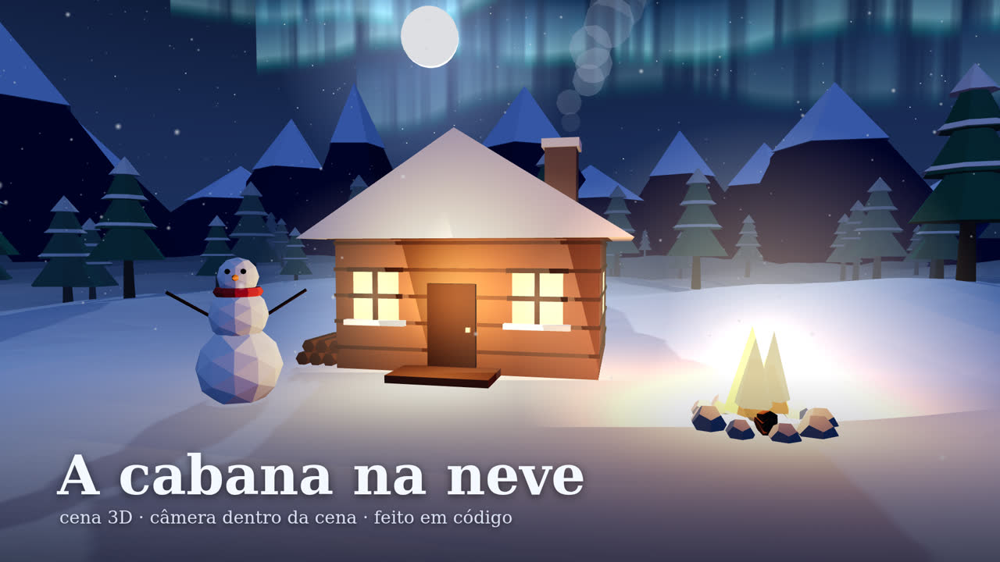
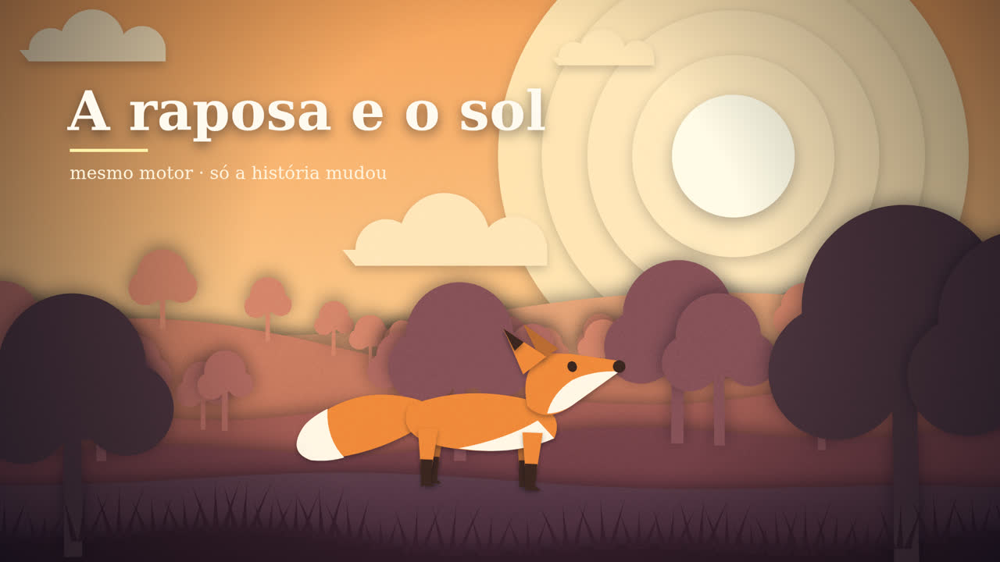

# filme-em-codigo ê¢â‚¬â€ um motor por estilo

<div align="center">
  
  <p><strong>Arckhé AI</strong></p>
</div>


**ê°Å¸â€¡Â§ê°Å¸â€¡Â· [PortuguêƒÂªs](README.md) ê‚· ê°Å¸â€¡Âºê°Å¸â€¡Â¸ [English](README.en.md) ê‚· ê°Å¸â€¡Âªê°Å¸â€¡Â¸ [EspaêƒÂ±ol](README.es.md)**

[](https://linnoff88-dev.github.io/

**Troque a roupa e o lugar da sua personagem sem a IA mudar o rosto dela.** O mêƒÂ©todo se chama
**um motor por estilo**: vocêƒÂª aprova a personagem uma vez e reaproveita em quantos filmes quiser.

## ê°Å¸â€œâ€“ Guia

Para entender o que o kit faz e como ele muda o seu dia (sem parte têƒÂ©cnica):
**https://linnoff88-dev.github.io/

## O que êƒÂ©

Cansou de pedir sêƒÂ³ uma roupa nova e receber outra personagem? Neste kit grêƒÂ¡tis, o Claude escreve
um **desenhista** em cêƒÂ³digo, que sabe desenhar um estilo, e uma **ficha** curta da cena: quem
aparece, onde, que hora e o que faz. Para um filme novo, vocêƒÂª troca a ficha e o desenhista fica,
por isso o rosto nêƒÂ£o muda. Serve para quem quer fazer filme animado sem saber programar. Precisa
do Claude Code (ou do Codex) e de um computador comum, sem placa de vêƒÂ­deo.

<sub>Os motores de exemplo deste kit foram escritos pelo Claude Fable 5.2.</sub>

VocêƒÂª pede um vêƒÂ­deo para a IA e a personagem muda de rosto a cada tomada, o filme acaba em poucos
segundos e cada tentativa nova gasta crêƒÂ©dito. Aqui o caminho êƒÂ© outro: o Claude **escreve um
programa que desenha o filme**, quadro por quadro. Sem modelo de vêƒÂ­deo e sem placa de vêƒÂ­deo.

O mêƒÂ©todo tem nome: **um motor por estilo**. VocêƒÂª cria o motor de um estilo uma vez. Depois,
filme novo êƒÂ© sêƒÂ³ trocar a histêƒÂ³ria. E o mesmo cêƒÂ³digo dêƒÂ¡ sempre o mesmo vêƒÂ­deo.

| | |
|---|---|
|  **camadas-planas** ê‚· recorte de papel |  **fundo-pintado** ê‚· fundo pintado + personagem de formas |
|  **cena-3d** ê‚· mundo 3D com a cêƒÂ¢mera dentro |  **marionete** ê‚· uma ilustraêƒÂ§êƒÂ£o mexida por êƒÂ¡reas |

Os quatro quadros acima saêƒÂ­ram dos motores deste repositêƒÂ³rio, nesta ordem: cêƒÂ³digo ê¢â€ â€™ quadros ê¢â€ â€™
som ê¢â€ â€™ MP4.

## Como funciona

1. **O motor** êƒÂ© uma pêƒÂ¡gina (HTML + JavaScript) que sabe desenhar um estilo. Ela tem uma funêƒÂ§êƒÂ£o,
   `desenhar(t)`, que desenha o quadro do segundo `t`.
2. **A histêƒÂ³ria** êƒÂ© um arquivo pequeno, `historia.json`: têƒÂ­tulo, cores, lugar, hora, roupa, aêƒÂ§êƒÂ£o.
3. **O render** abre a pêƒÂ¡gina num navegador sem tela, pede cada quadro (`t = 0`, `t = 1/30`,
   `t = 2/30`...) e guarda cada um como imagem.
4. **O som** tambêƒÂ©m êƒÂ© conta: o motor calcula cada amostra, nas mesmas marcas de tempo da imagem.
5. **O FFmpeg** junta os quadros e o som num MP4.

Como o tempo nêƒÂ£o vem do relêƒÂ³gio e os sorteios têƒÂªm semente, **renderizar duas vezes dêƒÂ¡ os mesmos
quadros** (o teste do kit compara o hash).

## Um motor por estilo: a prova

Mesmo motor, mesmos arquivos de cêƒÂ³digo. SêƒÂ³ o `historia.json` mudou.

| `historia.json` | `historia-2.json` |
|---|---|
|  |  |
| colina, de dia, uniforme, acena | praia, entardecer, vestido e chapêƒÂ©u, segura o chapêƒÂ©u |
|  |  |
| noite, lua, pinheiros, vaga-lumes | manhêƒÂ£, sol, êƒÂ¡rvores redondas |

A Lia tem o mesmo rosto nas duas porque êƒÂ© o mesmo cêƒÂ³digo que a desenha. No `fundo-pintado`, o
motor tem cerca de 46 KB de cêƒÂ³digo; cada histêƒÂ³ria tem menos de 1 KB.

## Como comeêƒÂ§ar (sem ser têƒÂ©cnico)

Abra o Claude Code, ou o Codex, numa pasta do seu computador e cole (troque a parte entre colchetes):

```text
Leia o kit "filme-em-codigo" em https://github.com/linnoff88-dev/filme-em-codigo (o README explica tudo, inclusive a instalaêƒÂ§êƒÂ£o).
Quero um filme animado com esta personagem: [descreva quem êƒÂ©, onde estêƒÂ¡, que hora êƒÂ© e o que faz].
Antes de fazer qualquer coisa, me responda em portuguêƒÂªs simples:
1. Qual dos 4 jeitos de animar combina com a minha ideia, e por quêƒÂª?
2. O que o meu computador precisa ter para fazer o filme?
3. O que o mêƒÂ©todo nêƒÂ£o vai conseguir fazer na minha ideia?
NêƒÂ£o instale nem crie nada ainda. Mostre o plano e espere eu dizer sim.
```

---

## InstalaêƒÂ§êƒÂ£o têƒÂ©cnica

### O que vocêƒÂª precisa

| O quêƒÂª | Para quêƒÂª | Como conferir |
|---|---|---|
| Node 22 ou mais novo | rodar o render | `node --version` |
| Chrome ou Chromium | tirar os quadros (sem abrir janela) | o render acha sozinho; ou `CHROME_PATH=/caminho` |
| FFmpeg | juntar quadros e som em MP4 | `ffmpeg -version` |
| Claude Code | escrever motores e histêƒÂ³rias novas | sêƒÂ³ para criar; para rodar os exemplos, nêƒÂ£o precisa |

NêƒÂ£o tem `npm install`. A three.js (para o exemplo 3D) jêƒÂ¡ estêƒÂ¡ em `vendor/three`.

### ComeêƒÂ§ar

```bash
git clone https://github.com/linnoff88-dev/filme-em-codigo.git
cd filme-em-codigo

# renderizar um exemplo (sai em saida/fundo-pintado/fundo-pintado.mp4)
node ferramentas/render.mjs exemplos/fundo-pintado

# o mesmo motor com outra histêƒÂ³ria
node ferramentas/render.mjs exemplos/fundo-pintado --historia historia-2.json

# sêƒÂ³ 3 quadros soltos, para olhar antes de renderizar tudo
node ferramentas/render.mjs exemplos/cena-3d --quadros 1,5,9

# assistir no navegador, com som, sem renderizar
node ferramentas/ver.mjs exemplos/marionete
```

## O processo, do inêƒÂ­cio ao fim

Quem faz: ê°Å¸Â§Â  vocêƒÂª com o Claude ê‚· ê¢Å¡â„¢ê¯Â¸Â script ê‚· ê°Å¸Â¤â€“ `claude -p` (o Claude sem conversa, numa linha de comando).

| # | Passo | Comando / aêƒÂ§êƒÂ£o | Quem |
|---|---|---|---|
| 1 | Escolher o jeito de animar | ler [METODOS.md](METODOS.md): camadas-planas, fundo-pintado, cena-3d ou marionete | ê°Å¸Â§Â  |
| 2 | Escolher o estilo | pegar um bloco em [prompts/estilos/](prompts/estilos/README.md) ou descrever o seu | ê°Å¸Â§Â  |
| 3 | Criar o motor (uma vez por estilo) | pedido [prompts/01-criar-motor.md](prompts/01-criar-motor.md), em conversa nova | ê°Å¸Â§Â  |
| 4 | Conferir 3 quadros soltos | `node ferramentas/render.mjs meus/<estilo> --quadros 1,4,7` e olhar; atêƒÂ© 3 rodadas | ê°Å¸Â§Â  + ê¢Å¡â„¢ê¯Â¸Â |
| 5 | Assistir no navegador (opcional) | `node ferramentas/ver.mjs meus/<estilo>` | ê¢Å¡â„¢ê¯Â¸Â |
| 6 | Renderizar o filme | `node ferramentas/render.mjs meus/<estilo>` ê¢â€ â€™ `saida/<estilo>/<estilo>.mp4` | ê¢Å¡â„¢ê¯Â¸Â |
| 7 | Ajustar com palavras | "mais devagar", "luz mais quente", na mesma conversa; repetir 4 e 6 | ê°Å¸Â§Â  |
| 8 | Filme novo no mesmo motor | pedido [prompts/02-nova-historia-mesmo-motor.md](prompts/02-nova-historia-mesmo-motor.md): sêƒÂ³ um `historia-N.json` | ê°Å¸Â§Â  ou ê°Å¸Â¤â€“ |
| 9 | Renderizar a nova histêƒÂ³ria | `node ferramentas/render.mjs meus/<estilo> --historia historia-N.json` | ê¢Å¡â„¢ê¯Â¸Â |
| 10 | Conferir que nada quebrou | `bash tests/rodar.sh` | ê¢Å¡â„¢ê¯Â¸Â |
| 11 | (Opcional) dar textura num gerador de vêƒÂ­deo | [prompts/06-hibrido-modelo-de-video.md](prompts/06-hibrido-modelo-de-video.md); fora do kit, pago | ê°Å¸Â§Â  |

Passo 8 sem conversa:

```bash
# --allowedTools deixa o Claude ler, criar arquivo e rodar sêƒÂ³ o render (testado em 19/11/2026)
claude -p "Use o motor de exemplos/camadas-planas. NêƒÂ£o altere o motor. Crie exemplos/camadas-planas/historia-3.json: a raposa numa floresta de outono, de dia. Renderize com node ferramentas/render.mjs exemplos/camadas-planas --historia historia-3.json e diga o caminho do MP4." \
  --allowedTools "Read" "Write" "Glob" "Grep" "Bash(node ferramentas/render.mjs:*)"
```

## Os 4 jeitos de animar

| Jeito | O que êƒÂ© | Exemplo | Quando usar |
|---|---|---|---|
| **camadas-planas** | formas planas em camadas; o fundo anda menos que a frente | [exemplos/camadas-planas](exemplos/camadas-planas) | recorte de papel, xilogravura, giz, vetor |
| **fundo-pintado** | cenêƒÂ¡rio pintado uma vez + personagem de formas animada por cima | [exemplos/fundo-pintado](exemplos/fundo-pintado) | personagem com rosto, estilo anime simples |
| **cena-3d** | um mundo 3D com luz e sombra, e a cêƒÂ¢mera andando dentro | [exemplos/cena-3d](exemplos/cena-3d) | passeio de cêƒÂ¢mera, profundidade, maquete |
| **marionete** | uma ilustraêƒÂ§êƒÂ£o pronta, entortada por pequenas êƒÂ¡reas | [exemplos/marionete](exemplos/marionete) | vocêƒÂª jêƒÂ¡ tem o desenho e quer sêƒÂ³ dar vida |

Detalhes, forêƒÂ§as e fraquezas de cada um: [METODOS.md](METODOS.md).

## Medido nesta mêƒÂ¡quina

Render dos exemplos em 19/11/2026: 10 segundos de filme, 1920êƒâ€”1080, 30 quadros por segundo
(300 quadros), **sêƒÂ³ CPU, sem placa de vêƒÂ­deo**, 4 navegadores em paralelo, teto de 8 GB de memêƒÂ³ria.
Cada linha vem do `medida.json` do exemplo.

| Exemplo | Render completo | Por quadro | NêƒÂºcleos usados (mêƒÂ©dia) | MemêƒÂ³ria (pico) | MP4 |
|---|---|---|---|---|---|
| camadas-planas | 30,8 s | 87 ms | 3,4 de 20 | 2,6 GB | 5,5 MB |
| fundo-pintado | 25,5 s | 62 ms | 3,6 de 20 | 2,5 GB | 9,1 MB |
| cena-3d | 45,3 s | 104 ms | 10,7 de 20 | 2,3 GB | 7,3 MB |
| marionete | 37,0 s | 98 ms | 3,2 de 20 | 3,1 GB | 5,4 MB |

MêƒÂ¡quina: CPU Arm Cortex-X925 de 20 nêƒÂºcleos, Linux, Chrome 158 (WebGL calculado pela CPU,
SwiftShader), FFmpeg 6.1.1. Em outra mêƒÂ¡quina os tempos mudam. O que custa de verdade êƒÂ© a conversa
com o Claude, nêƒÂ£o o render: [CUSTO.md](CUSTO.md).

Para medir na sua: `bash ferramentas/medir-tudo.sh`.

## O que tem aqui

| Pasta / arquivo | O que êƒÂ© |
|---|---|
| `exemplos/<jeito>/` | um motor de cada jeito: `index.html`, `motor.js`, `historia.json`, `medida.json`, `quadro.jpg` |
| `comum/filme.js` | a parte igual de todo motor: lêƒÂª a histêƒÂ³ria, cria a tela, combina com o render, player de prêƒÂ©-visualizaêƒÂ§êƒÂ£o |
| `comum/som.js` | som feito em cêƒÂ³digo: nota, sino, corda, vento, batida, eco de sala |
| `ferramentas/render.mjs` | pêƒÂ¡gina ê¢â€ â€™ quadros PNG ê¢â€ â€™ som WAV ê¢â€ â€™ MP4. Sem dependêƒÂªncia de npm |
| `ferramentas/ver.mjs` | assistir o motor no navegador |
| `ferramentas/medir-tudo.sh` | renderiza todos os exemplos e grava as medidas |
| `prompts/` | os 6 pedidos prontos e a [biblioteca de estilos](prompts/estilos/README.md) (31 estilos) |
| `tests/` | render curto, mesmo cêƒÂ³digo = mesmos quadros, MP4 com vêƒÂ­deo e som |
| `vendor/three/` | three.js 0.187.0 (licenêƒÂ§a MIT), para o exemplo 3D rodar sem internet |

## O contrato do motor

Todo motor expêƒÂµe isto na pêƒÂ¡gina (quem cria êƒÂ© o `comum/filme.js`):

```js
window.FILME = {
  largura, altura, fps, duracao,
  tela,          // o canvas onde tudo êƒÂ© desenhado
  pronto,        // promessa: resolve quando histêƒÂ³ria e imagens carregaram
  desenhar(t),   // desenha o quadro do segundo t ê¢â‚¬â€ conta pura, sem relêƒÂ³gio e sem memêƒÂ³ria
  som(),         // devolve { taxa, esq, dir }: as amostras do som, calculadas em cêƒÂ³digo
};
```

TrêƒÂªs regras fazem o mêƒÂ©todo funcionar:

- **`desenhar(t)` nêƒÂ£o lembra do quadro anterior.** Vento, partêƒÂ­cula, cêƒÂ¢mera: tudo sai de `t`.
- **Sorteio sêƒÂ³ com semente** (`Filme.sorteio(semente)`). Nada de `Math.random`.
- **Nada da histêƒÂ³ria dentro do motor.** O que muda entre episêƒÂ³dios mora no `historia.json`.

## Pedidos prontos

| Arquivo | Para quêƒÂª |
|---|---|
| [01-criar-motor.md](prompts/01-criar-motor.md) | criar o motor de um estilo, com conferêƒÂªncia de 3 quadros |
| [02-nova-historia-mesmo-motor.md](prompts/02-nova-historia-mesmo-motor.md) | filme novo sem mexer no motor |
| [03-com-sua-referencia.md](prompts/03-com-sua-referencia.md) | partir de uma imagem sua |
| [04-grade-storyboard.md](prompts/04-grade-storyboard.md) | grade 2êƒâ€”2 de quadros-chave ê¢â€ â€™ animaêƒÂ§êƒÂ£o que passa de um ao outro |
| [05-gastar-menos.md](prompts/05-gastar-menos.md) | as alavancas de custo, em pedidos |
| [06-hibrido-modelo-de-video.md](prompts/06-hibrido-modelo-de-video.md) | usar o MP4 como referêƒÂªncia num gerador de vêƒÂ­deo (sêƒÂ³ documentado) |
| [estilos/](prompts/estilos/README.md) | 31 estilos "mesmo estilo, sua ideia", pelos 4 jeitos |

## Testes

```bash
bash tests/rodar.sh
```

Para cada exemplo: renderiza 1 segundo, confere que o MP4 tem vêƒÂ­deo e som, renderiza de novo em
outro lanêƒÂ§amento (com 1, 2 e 3 navegadores) e compara o hash dos quadros, confere que os quadros
mudam com o tempo, e que a segunda histêƒÂ³ria dêƒÂ¡ outro filme no mesmo motor. Rodam sem internet.

"Mesmo cêƒÂ³digo = mesmo vêƒÂ­deo" foi conferido **na mesma mêƒÂ¡quina e no mesmo navegador**. Entre
mêƒÂ¡quinas diferentes, as fontes de letra e a versêƒÂ£o do navegador podem mudar alguns pixels.

## O que este mêƒÂ©todo nêƒÂ£o faz

Fotorrealismo, rosto humano realista, luta, danêƒÂ§a, fala com boca sincronizada. Veja
[LIMITES.md](LIMITES.md), com as saêƒÂ­das: o caminho hêƒÂ­brido e o Blender.

## Kits irmêƒÂ£os

- **video-codigo**: vêƒÂ­deo em HTML/Canvas com voz local presa êƒÂ  palavra ê¢â‚¬â€ https://linnoff88-dev.github.io/
- **sincronia-em-codigo**: relêƒÂ³gio êƒÂºnico para imagem, contador e som; sêƒÂ©ries por planilha ê¢â‚¬â€ https://linnoff88-dev.github.io/
- **estilo-em-skill**: o estilo de um vêƒÂ­deo vira uma skill reutilizêƒÂ¡vel ê¢â‚¬â€ https://linnoff88-dev.github.io/

RepositêƒÂ³rios de cêƒÂ³digo aberto que servem a este mêƒÂ©todo, conferidos um a um: [REFERENCIAS.md](REFERENCIAS.md).

## LicenêƒÂ§a

MIT. Veja [LICENSE](LICENSE). A three.js em `vendor/three` tem licenêƒÂ§a MIT prêƒÂ³pria (`vendor/three/LICENSE`).
ConteêƒÂºdo aberto e gratuito do ARCKHê‰ AI.

---

<div align="center">
  
  <p><strong>Arckhé AI</strong></p>
</div>